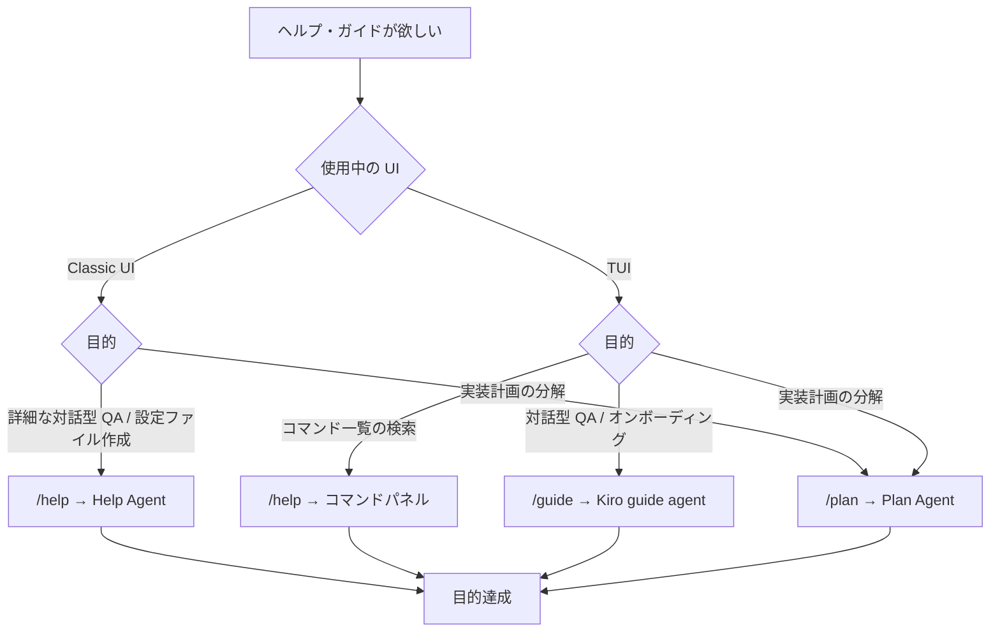

[ホーム](../README.md) > [機能詳細ガイド](README.md) > Kiro guide agent

---

# Kiro guide agent（`/guide` コマンド）

## 概要

**Kiro CLI v1.29.7（2026-04-10 リリース）で追加された、TUI 専用のオンボーディング・ヘルプ用組み込みエージェント**です。`/guide` スラッシュコマンドで Kiro guide agent に切り替えます。

### 🆕 Kiro CLI の Built-in Agent 4 種類

Kiro CLI には 4 種類の組み込みエージェントがあり、用途ごとに使い分けます:

| Agent | コマンド | 用途 | 導入バージョン |
|-------|--------|------|-------------|
| **kiro_default** | （デフォルト） | 汎用のコード支援 | - |
| **[kiro_help](14_HelpAgent.md)** | `/help` | CLI ドキュメントベースの詳細 QA、設定ファイル作成支援 | v1.25.0 |
| **kiro_planner** | `/plan` / `Shift+Tab` | 複雑なアイデアを実装計画に分解 | v1.23.0 |
| **Kiro guide agent** ⭐ | `/guide` | **オンボーディング・TUI でのヘルプ** | **v1.29.7** |

### Kiro guide agent が提供する体験（公式説明に基づく）

公式 [Slash commands の `/guide`](https://kiro.dev/docs/reference/slash-commands/#guide)（公式更新日 2026-10-24）と [Built-in agents の Guide agent](https://kiro.dev/docs/custom-agents/built-in/#guide-agent-cli-only)（公式更新日 2026-10-02）は、Guide agent を次のように説明しています。

- **ドキュメントに基づくヘルプとオンボーディング**: Kiro CLI の機能・コマンド・ツール・設定についての質問に、インデックス化されたドキュメントを使って答える。汎用の知識で答えるデフォルトエージェントと違い、インストール済みのバージョンに対応したドキュメントを検索する
- **設定ファイルの作成**: `.kiro/` ディレクトリに、エージェント・プロンプト・steering ファイルを作成できる
- **CLI のみ**: 公式 Built-in agents の表で、Guide は IDE ではなく CLI の欄に印が付いている（ターミナル UI 向け）

公式 TUI 比較ページ（[https://kiro.dev/docs/cli/terminal-ui/comparison/](https://kiro.dev/docs/cli/terminal-ui/comparison/)）にも `/guide` の行があります。

### なぜ `/guide` が必要なのか

**v2.0.0 で TUI がデフォルト化された際に、`/help` コマンドの挙動が Classic UI と TUI で異なる** ようになりました:

| UI モード | `/help` の挙動 |
|---------|--------------|
| **Classic UI** | Launches a help agent for interactive Q&A（Help Agent を起動） |
| **TUI** | **Opens a searchable command panel**（検索可能なコマンドパネルを開く） |

そのため、TUI では **「対話型の Q&A でヘルプを得る手段」が必要** となり、`/guide` がその役割を担うために設計されました。

> **💡 ワンポイント**: TUI では `/help` がコマンド一覧のパネル表示に変わるため、Help Agent のような対話型ヘルプが欲しい場合は **`/guide` を使用** します。

---

## 📋 目次

- [/help / /plan / /guide の使い分け](#help--plan--guide-の使い分け)
- [使い方](#使い方)
- [仕組み（公開情報）](#仕組み公開情報)
- [調査で判明した事実と未確認事項](#調査で判明した事実と未確認事項)
- [Help Agent との違い](#help-agent-との違い)
- [TUI 環境での位置づけ](#tui-環境での位置づけ)
- [注意点・制限事項](#注意点制限事項)
- [関連リンク](#関連リンク)

---

## /help / /plan / /guide の使い分け

### 使い分けフローチャート



### 簡易対応表

| やりたいこと | Classic UI | TUI |
|----------|-----------|-----|
| CLI の使い方を学びたい | `/help` （Help Agent） | `/guide` （Kiro guide agent） |
| コマンド一覧を見たい | `/help --legacy` | `/help` （コマンドパネル） |
| 特定コマンドのヘルプ | `/help --legacy <command>` | `/help` パネル内で検索 |
| 詳細な対話型 QA | `/help` | **`/guide`** |
| 実装計画を立てる | `/plan` / `Shift+Tab` | 同左 |
| 設定ファイル作成を依頼 | `/help` | `/guide`（公式 Slash commands が、`.kiro/` にエージェント・プロンプト・steering ファイルを作成できると説明） |

---

## 使い方

### 基本的な切り替え

TUI モードで以下を入力すると、Kiro guide agent に切り替わります:

```bash
> /guide
```

以降、Guide agent に質問できます。

### 元のエージェントに戻る

公式 Slash commands の `/guide` の節は、`Shift+Tab` または `/agent swap` で直前のエージェントに戻れると説明しています。再度 `/guide` を実行したときにトグルするかは、公式に記載がなく**未確認**です。

---

## 仕組み（公開情報）

### 確定している情報（公式・CLI 内蔵）

| 項目 | 内容 | 出典 |
|------|------|------|
| 導入バージョン | **v1.29.7（2026-04-10）** | `kiro-cli version --changelog=1.29.7` |
| CLI 内蔵 changelog の記述 | `Added /guide command to swap to the Kiro guide agent` | CLI 内蔵 changelog |
| 対応 UI | **ターミナル UI 専用**。Classic では `/help` を使う | [Slash commands の `/guide`](https://kiro.dev/docs/reference/slash-commands/#guide)、[terminal-ui/comparison](https://kiro.dev/docs/cli/terminal-ui/comparison/) |
| 用途 | ドキュメントに基づくヘルプとオンボーディング。`.kiro/` にエージェント・プロンプト・steering ファイルを作成できる | Slash commands の `/guide` |
| 検索の仕組み | **introspect** ツールによる、セマンティック検索と BM25 のハイブリッド検索。対象はコンパイル時に埋め込まれたインデックス済みドキュメントで、インストール済みのバージョンに対応する | [Built-in agents の Guide agent](https://kiro.dev/docs/custom-agents/built-in/#guide-agent-cli-only)（公式更新日 2026-10-02） |
| 質問できる内容 | コマンド（スラッシュコマンド・CLI コマンドとそのオプション）、設定、機能（MCP・hooks・steering・カスタムエージェント・サブエージェント・コードインテリジェンス）、`.kiro/` のファイル作成 | 同上 |
| 戻り方 | `Shift+Tab` または `/agent swap` | Slash commands の `/guide` |

### 関連する他機能

- [Terminal UI（TUI）機能](18_TerminalUI.md) - `/guide` が動作する TUI モードの詳細
- [Help Agent](14_HelpAgent.md) - Classic UI でのヘルプ体験
- [v2.0.0 メジャーアップデート](16_v2MajorUpdate.md) - TUI デフォルト化の文脈

---

## 調査で判明した事実と未確認事項

本セクションは、2026-05-10 に実施した詳細調査の結果をまとめたものです（調査計画書・結果報告書は本プロジェクトのリポジトリ外の作業記録に保管）。

### ✅ 確定している事実

- `/guide` は **v1.29.7 で追加** された
- **TUI 専用**と公式に位置付けられている
- `/help` の挙動が TUI で変わる（コマンドパネル化）ため、**対話型ヘルプの代替**として設計された

### ✅ 公式ドキュメントでの確認状況（以前の「未整備」を更新）

2026-05-10 の調査時点では、`/guide` の専用ページ・スラッシュコマンドリファレンスでの言及・公式 Changelog での言及はいずれも確認できませんでした。現在の公式ドキュメントでは、次のとおり確認できます。

| 項目 | 現状 |
|------|------|
| `/guide` の説明 | 公式 [Slash commands の `/guide`](https://kiro.dev/docs/reference/slash-commands/#guide)（公式更新日 2026-10-24）に節がある |
| Guide agent の専用の解説 | 公式 [Built-in agents の Guide agent (CLI only)](https://kiro.dev/docs/custom-agents/built-in/#guide-agent-cli-only)（公式更新日 2026-10-02）に節がある。専用ページ `/docs/cli/chat/guide-agent/` 等は引き続きない（Built-in agents ページに統合） |
| 公式 Changelog ページ（`/changelog/cli/1-29/`）での言及 | 本サイトでは再確認していない（**未確認**）。導入バージョン v1.29.7 は CLI 内蔵 changelog による |
| TUI 比較ページ | [terminal-ui/comparison](https://kiro.dev/docs/cli/terminal-ui/comparison/) に `/guide` の行がある |

### ❓ 一次情報から確認できなかった事項（**推測を避けるため未記述**）

| 項目 | 調査状況 |
|------|---------|
| 内部エージェント名（`kiro_guide` 等） | `kiro-cli agent list` に表示されず、バイナリからも検出不可 |
| 使用ツール・プロンプトインジケーター | バイナリ strings で `[guide]` 等は検出不可 |
| 情報源・知識ベース | 新規の埋め込みドキュメントは検出不可（既存の `introspect` 利用の可能性あり） |
| 初回オンボーディングの具体的フロー | 公開情報なし |
| トグル動作の有無 | 公開情報なし |

> **⚠️ 注意**: 上記「確認できなかった事項」について本サイトでは**推測での記述を避けています**。公式ドキュメントの更新を注視し、判明次第反映します。

---

## Help Agent との違い

### 比較表

| 項目 | [Help Agent](14_HelpAgent.md) | Kiro guide agent |
|------|--------------------|-----------------|
| **コマンド** | `/help` | `/guide` |
| **導入バージョン** | v1.25.0（2026-02-03） | v1.29.7（2026-04-10） |
| **対応 UI** | Classic UI / TUI 両対応（TUI では別挙動） | **TUI 専用** |
| **エージェント名** | `kiro_help`（`agent list` で確認可能） | 未公開（`agent list` に非表示） |
| **公式の解説** | ✅ [Built-in agents の Help agent](https://kiro.dev/docs/custom-agents/built-in/#help-agent-cli-only) | ✅ [Built-in agents の Guide agent](https://kiro.dev/docs/custom-agents/built-in/#guide-agent-cli-only)、[Slash commands の `/guide`](https://kiro.dev/docs/reference/slash-commands/#guide) |
| **主な用途** | CLI 機能・設定・コマンドの詳細 QA、設定ファイル作成支援 | ドキュメントに基づくヘルプとオンボーディング、`.kiro/` のファイル作成（公式）。公式は、ターミナル UI では Help agent が Guide agent に置き換わったと説明 |
| **使用ツール** | `introspect`、`fs_write`（`.kiro/**` `~/.kiro/**` 限定） | `introspect`（公式 Built-in agents）。そのほかのツールは公式に記載がなく未確認 |
| **プロンプトインジケーター** | `[help]`（紫色） | 未公開 |
| **MCPサーバー** | 無効（`includeMcpJson: false`） | 未公開 |
| **オフライン対応** | ✅ 可能（バイナリ内蔵ドキュメント参照） | ドキュメントはコンパイル時に埋め込まれる（公式）。オフラインでの動作は公式に記載がなく未確認 |

### 共通点

- Kiro CLI の built-in エージェントとして組み込まれている
- `/help`・`/guide` のスラッシュコマンドで切替可能
- スペシャリスト系エージェント（汎用の `kiro_default` より特化した用途）

---

## TUI 環境での位置づけ

### v2.x で強化された TUI 体験における `/guide` の役割

TUI モードがデフォルト化された v2.0.0 以降、TUI はデフォルトのユーザー体験になりました。その中で、ヘルプ・オンボーディング系コマンドは以下のように再編されています:

| TUI 専用コマンド | 役割 |
|-------------|------|
| **`/guide`** | ヘルプ・オンボーディング（Kiro guide agent 切替） |
| `/theme` | テーマカラーのカスタマイズ |
| `/transcript` | 会話トランスクリプトを `$PAGER` で表示 |
| `/copy` | 最後のアシスタントレスポンスをクリップボードにコピー |
| `/spawn` | 並列エージェントセッション実行 |
| `/feedback` | フィードバック送信（Classic の `/issue` を置換） |

参考: [Terminal UI 機能](18_TerminalUI.md)

---

## 注意点・制限事項

### Classic UI との互換性

- **`/guide` は公式に TUI 専用**と位置付けられています
- 公式 Slash commands は、`/guide` はターミナル UI でのみ使え、Classic インターフェースでは同じ対話型のエージェント体験に `/help` を使うと説明しています。Classic で `/guide` を実行したときの表示は、公式に記載がなく**未確認**です
- Classic UI で対話型ヘルプが欲しい場合は **`/help`**（Help Agent）を使用してください

### 公式ドキュメント状況

- 公式の説明は Slash commands の `/guide` と Built-in agents の Guide agent の節にあります。内部のエージェント名、使うツールの一覧、プロンプトのインジケーターなど、上の「確認できなかった事項」は引き続き公式に記載がなく**未確認**です

### 他エージェントとの切替

- `/agent swap <name>` での切替時、エージェント別のモデル設定がない限り現在のモデルは維持されます
- `/guide` から直前のエージェントへ戻るには、`Shift+Tab` または `/agent swap` を使います（公式 Slash commands）。Guide agent が `/agent list` に表示されない件は、本サイトの調査時（2026-05-10）の実機の結果で、現在の公式には記載がありません

---

## 関連リンク

### 公式ドキュメント

- [Kiro CLI 公式サイト](https://kiro.dev/cli/)
- [Kiro CLI Terminal UI 比較](https://kiro.dev/docs/cli/terminal-ui/comparison/) - `/guide` の行
- [Slash commands の `/guide`](https://kiro.dev/docs/reference/slash-commands/#guide) - `/guide` の説明
- [Built-in agents の Guide agent (CLI only)](https://kiro.dev/docs/custom-agents/built-in/#guide-agent-cli-only) - Guide agent の公式解説
- [Kiro CLI Built-in agents - Help agent (CLI only)](https://kiro.dev/docs/custom-agents/built-in/#help-agent-cli-only) - Help Agent の公式解説（個別ページから統合ページ内セクションへ変更）
- [Kiro CLI スラッシュコマンドリファレンス](https://kiro.dev/docs/reference/slash-commands/)

### 関連機能（本サイト内）

- [14. Help Agent](14_HelpAgent.md) - Classic UI でのヘルプ体験
- [16. v2.0.0 メジャーアップデート](16_v2MajorUpdate.md) - TUI デフォルト化の経緯
- [18. Terminal UI 機能](18_TerminalUI.md) - `/guide` が動作する TUI の詳細
- [02. サブエージェント機能](02_Subagents.md) - Plan Agent も含むエージェント機能全般

### リファレンス（辞書）
- [04_reference/02_slash-commands.md](../04_reference/02_slash-commands.md) — `/guide` の正規仕様

### 調査記録

本機能の詳細調査は 2026-05-10 に実施しました。調査計画書・結果報告書・関連する過去調査は、本プロジェクトのリポジトリ外（作業記録ディレクトリ）に保管されています。主な内容:

- Kiro guide agent 詳細調査計画書 Rev.2（2026-05-10）
- Kiro guide agent 詳細調査結果報告書（2026-05-10）
- Help Agent + /guide 差分調査報告書（2026-05-10）
- Help Agent コンテキスト調査報告書（2026-03-15、v1.26.0 時代）

---

**最終更新**: 2026-10-29（公式 Slash commands・Built-in agents の記述に合わせて更新。2026-05-10 の調査時点では公式の記載なし）  
**対象バージョン**: Kiro CLI v1.29.7+（TUI モード）  
**公式ドキュメント状況**: Slash commands の `/guide` と Built-in agents の Guide agent の節に記載あり
